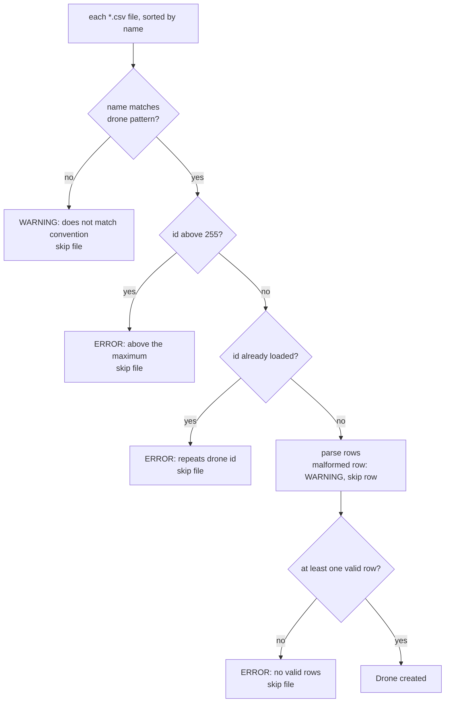

# Animation Format

An animation is a directory with one CSV file per drone and, optionally, one JSON file with the serial settings. This page describes exactly what `Loader` (`ControlTower/Loader/Loader.py`) accepts, what it skips, and what it logs when it skips something.

> **How this page was checked:** the rules come from reading `Loader.py`. The skip and error messages in the tables were produced by running `Loader` on a scratch directory on Windows (Python 3.12.10); the behavior is also covered by `tests/ControlTower/Loader/test_Loader.py`.

## Directory layout

```text
my_animation/
  config.json      optional: serial settings (any *.json file name works)
  drone_0.csv      one file per drone
  drone_1.csv
  drone_2.csv
```

The bundled example is `sample_animation/`: three drones, 12 frames each, one frame every 500 ms (about 5.5 s in total), `loop://` at 115200 baud.

## Drone CSV files

### File names

The drone id is the number in the file name. The name must match this regular expression (case-insensitive):

```text
^(?:drone_?)?(\d+)\.csv$
```

| File name | Result |
|-----------|--------|
| `drone_3.csv`, `drone3.csv`, `Drone7.csv`, `DRONE_3.csv`, `3.csv` | accepted (ids 3, 3, 7, 3, 3) |
| `drone_a.csv`, `mydrone_1.csv`, `drone_.csv`, `drone_1.txt` | not a drone file (a `.csv` that does not match is skipped with a warning; other extensions are ignored) |

The id must be in the range 0 to 255 because it is sent as one byte (`MAX_DRONE_ID = 255`). Ids do not need to be contiguous or start at 0. Drones are returned sorted by id.

### Columns

Rows have **no header** and exactly these columns, in this order:

| # | Column | Parsed as | Unit / range |
|---|--------|-----------|--------------|
| 0 | `timestamp_ms` | `int` | milliseconds from the start of the animation |
| 1 | `x` | `float` | unit not defined in code |
| 2 | `y` | `float` | unit not defined in code |
| 3 | `z` | `float` | unit not defined in code |
| 4 | `r` | `int` | red, 0 to 255 |
| 5 | `g` | `int` | green, 0 to 255 |
| 6 | `b` | `int` | blue, 0 to 255 |

Notes:

- The code defines the timestamp unit (milliseconds). It does **not** define the unit or the orientation of x, y and z; they are sent to the drone as given. Check what your drone firmware expects.
- Extra columns after the seventh are ignored. A row with fewer than seven columns is malformed.
- Rows are kept in file order. They are not sorted by timestamp.
- The files are read with Python's `csv` module, so quoted fields work. Python's `int()` and `float()` accept surrounding spaces.
- A header line such as `timestamp_ms,x,y,z,r,g,b` is not recognized as a header. It is treated as a malformed row, skipped, and logged as a warning.

### Value limits and when they are enforced

The loader does **not** check ranges. A colour of `300` or an x of `70000` loads fine. The limits are checked when the frame is sent, in the dispatcher thread:

- x, y, z must be finite and fit in float16 (largest magnitude 65504; see [Serial-Protocol](Serial-Protocol.md#float16-encoding)).
- r, g, b must be integers from 0 to 255.

A frame that breaks these limits raises `ValueError` while it is being sent. The dispatcher thread of that drone ends with a traceback on the console, and the drone shows as `Ended`. See [Troubleshooting](Troubleshooting.md#a-drone-goes-to-ended-early-with-a-traceback-on-the-console).

## Timing

The [Scheduler](Scheduler-and-Drone-Lifecycle.md) plays the frames in file order:

- The first row is sent immediately, whatever its timestamp.
- Each later frame waits for the difference between its timestamp and the previous row's timestamp, minus the time the previous send took.
- A timestamp that is smaller than the previous one is kept; it gives a wait of zero (the wait is never negative).
- Drones do not share a clock. Each drone has its own thread, and `Start all` starts them one after another in a loop, so there is no start barrier between drones.

## Serial settings file

The directory may contain a JSON file with the serial settings:

```json
{
  "serial_port": "loop://",
  "serial_speed": 115200,
  "ping_timeout": 1
}
```

| Key | Converted with | Meaning |
|-----|----------------|---------|
| `serial_port` | `str()` | device name or pyserial URL (`COM3`, `/dev/ttyUSB0`, `loop://`) |
| `serial_speed` | `int()` | baud rate |
| `ping_timeout` | `int()` | used as the serial **read timeout in seconds** |

Rules (all checked by running `Loader.load_config()`):

- All three keys are required. Other keys are ignored.
- `ping_timeout` is converted with `int()`, so `2.9` becomes `2`. It is not a ping: the value is passed to pyserial as the read timeout.
- Any `*.json` file in the directory counts, so keep only the config there. If there are several, the first by sorted name is used and a warning names the file that was chosen.
- Command-line flags override the file only when `--port`, `--speed` and `--timeout` are all given. See [Getting-Started](Getting-Started.md#serial-settings).

## What happens on errors

Parsing problems never raise. They are logged and the affected config, file or row is skipped. Only a missing or non-directory path raises (`FileNotFoundError`, `NotADirectoryError`), and both entry points turn that into a one-line message and exit code 2.

| Condition | Level | Effect |
|-----------|-------|--------|
| Directory does not exist | exception | `Animation directory not found: <path>` |
| Path is not a directory | exception | `Animation path is not a directory: <path>` |
| `.csv` name does not match the pattern | WARNING | `File: <path>, does not match convention, and will be dropped!` |
| Id above 255 | ERROR | `File: <path> has drone id 300, above the maximum of 255, and will be dropped!` |
| Id already loaded from another file | ERROR | `File: <path> repeats drone id 1, already loaded from 1.csv, and will be dropped!` |
| File has no valid row (empty, or all rows malformed) | ERROR | `File: <path> has no valid rows and will be dropped!` |
| File cannot be opened or read | ERROR | `Couldn't open/read file: <path>, file will be dropped!` |
| Malformed row (blank line, text where a number is expected, fewer than 7 columns) | WARNING | `Skipping malformed row in <path>, line 3: ['abc', '1', ...] (<python error>)`; the row is skipped |
| No `*.json` file | WARNING | `No config file with JSON format found in directory: <dir>. Default configuration will be used!` |
| More than one `*.json` file | WARNING | `Found 2 JSON files in <dir>, using a.json` |
| JSON is not an object, or a key is missing | ERROR | `Configuration file: <path>, misses or does not have conventionally named configuration entries (...)` |
| JSON is invalid, or a value cannot be converted | ERROR | `Invalid config file <path> (<python error>)` |

Details worth knowing:

- Despite the wording "Default configuration will be used!", there is no default serial configuration. Without a usable config and without all three flags, the program exits with `No serial config detected`.
- A blank line counts as a malformed row (the CSV reader returns an empty list for it), so blank lines produce a warning.
- When two files have the same id (for example `1.csv` and `drone_1.csv`), the one that comes first in sorted file-name order wins. In the run below, `1.csv` beat `drone_1.csv`.
- These messages are logged before the UI starts. They appear on the console (Python's last-resort handler prints WARNING and above), not in the TUI log pane. See [Presenter-API](Presenter-API.md#log-buffer-and-startup-messages).

### Loader decision flow



## Verified run

Run from the repository root with `.venv\Scripts\python.exe`. This loads the bundled sample:

```python
import sys
sys.path.insert(0, ".")
from ControlTower.Loader import Loader

port, speed, timeout, drones = Loader("sample_animation").load()
print((port, speed, timeout), [(d.id, d.animation_len) for d in drones])
```

Output:

```text
('loop://', 115200, 1) [(0, 12), (1, 12), (2, 12)]
```

A second run used a scratch directory (created in the system temp folder and deleted afterwards) that contains every error case above, loaded with `Loader(directory).load_drones()` and `load_config()`. Its files were:

| File | Content | Result |
|------|---------|--------|
| `drone_0.csv` | 6 lines: one good row, a blank line, `abc,1,2,3,0,0,0`, `500,1,2`, a row with 8 columns, and `250,1,2,3,0,0,0` | 3 frames kept (timestamps 0, 500, 250); 3 rows skipped with warnings (lines 2, 3 and 4) |
| `1.csv` and `drone_1.csv` | one row each | `1.csv` loaded, `drone_1.csv` dropped as a duplicate |
| `drone_300.csv` | one row | dropped, id above 255 |
| `drone_5.csv` | empty | dropped, no valid rows |
| `Drone7.csv`, `DRONE_3.csv` | one row each | loaded as ids 7 and 3 |
| `drone_a.csv`, `mydrone_1.csv` | one row each | dropped, name does not match |
| `drone_9.txt` | one row | ignored (not a `.csv`) |

The log lines were exactly the ones shown in the error table, for example:

```text
WARNING Skipping malformed row in ...\drone_0.csv, line 2: [] (list index out of range)
WARNING Skipping malformed row in ...\drone_0.csv, line 3: ['abc', '1', '2', '3', '0', '0', '0'] (invalid literal for int() with base 10: 'abc')
WARNING Skipping malformed row in ...\drone_0.csv, line 4: ['500', '1', '2'] (list index out of range)
ERROR File: ...\drone_1.csv repeats drone id 1, already loaded from 1.csv, and will be dropped!
ERROR File: ...\drone_300.csv has drone id 300, above the maximum of 255, and will be dropped!
ERROR File: ...\drone_5.csv has no valid rows and will be dropped!
WARNING File: ...\drone_a.csv, does not match convention, and will be dropped!
WARNING File: ...\mydrone_1.csv, does not match convention, and will be dropped!
```

Config checks on the same scratch directory: no JSON gave the "No config file" warning and `None`; two JSON files gave the "Found 2 JSON files" warning and used `a.json`; a missing key, a non-object, an invalid JSON text and a non-numeric value each gave an ERROR line and `None`; a valid file with `"ping_timeout": 2.9` returned `('COM4', 9600, 2)`.

## Example: the first rows of `drone_0.csv`

```text
0,0,0,1,255,0,0
500,0.5,0,1.2,255,0,0
1000,1,0,1.4,255,0,0
```

| Row | Meaning |
|-----|---------|
| `0,0,0,1,255,0,0` | at t = 0 ms: position (0, 0, 1), colour red (255, 0, 0). Sent as soon as the drone is started |
| `500,0.5,0,1.2,255,0,0` | 500 ms after the first frame: position (0.5, 0, 1.2), still red |
| `1000,1,0,1.4,255,0,0` | 1000 ms: position (1, 0, 1.4), still red |

`drone_1.csv` is green (`0,255,0`) and `drone_2.csv` is blue (`0,0,255`).

## Authoring checklist

- One `drone_<n>.csv` per drone, with `n` from 0 to 255 and no duplicates.
- No header line and no blank lines.
- Seven columns per row: integer milliseconds, three floats, three integers from 0 to 255.
- Timestamps that increase from row to row.
- Coordinates inside float16 range (|value| up to 65504).
- At most one `.json` file in the folder, with all three keys, or pass `--port`, `--speed` and `--timeout` together.
- Try the animation over `loop://` first. See [Home](Home.md#safety-notes).

## Known issues

- The `DroneFileNameReadError` docstring in `ControlTower/common/errors.py` shows the pattern `^(drone_?|Drone_?)?[0-9]+\.csv$`. The code uses the regular expression shown above; this page follows the code.
- The JSON key `ping_timeout` is named like a ping interval but is used as the serial read timeout.

## See also

- [Getting-Started](Getting-Started.md)
- [Serial-Protocol](Serial-Protocol.md)
- [Scheduler-and-Drone-Lifecycle](Scheduler-and-Drone-Lifecycle.md)
- [Troubleshooting](Troubleshooting.md)
