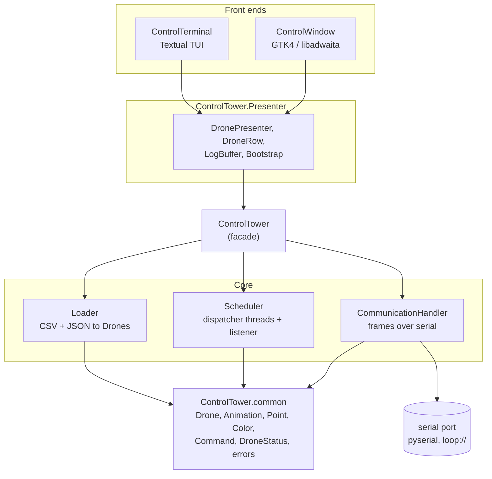
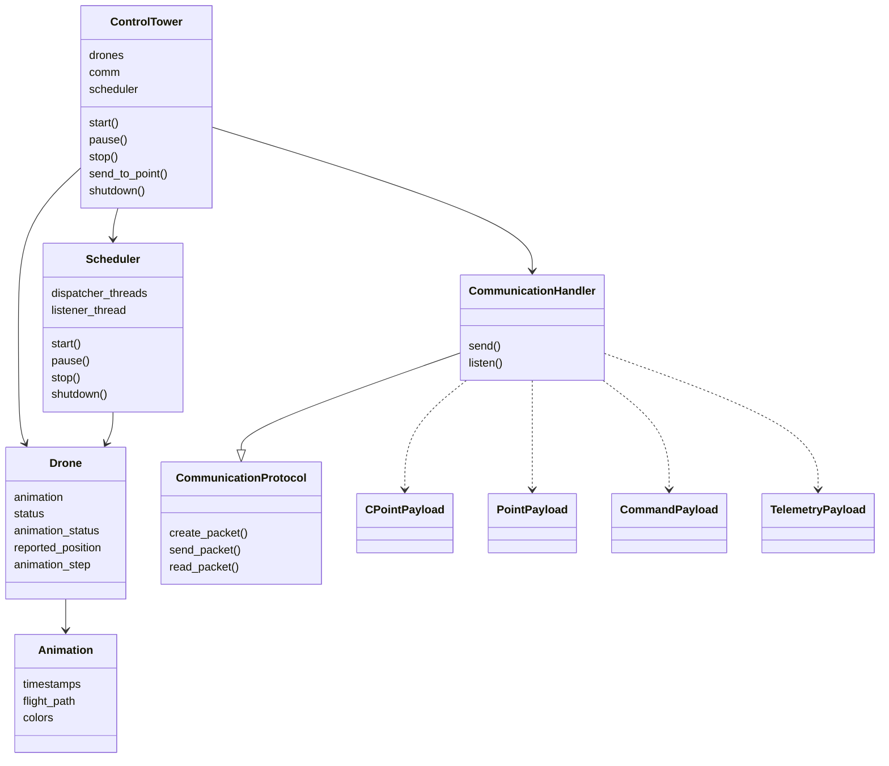
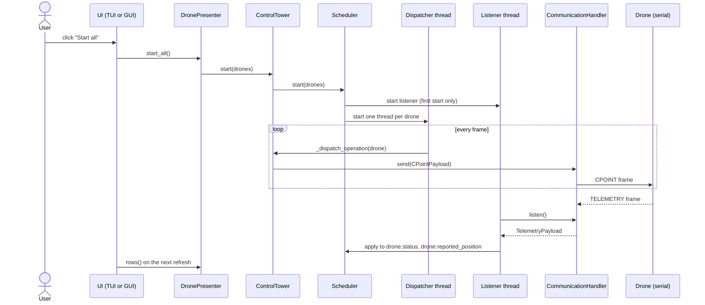
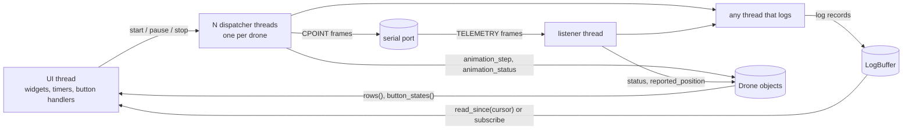

# Architecture

How Hen-Brush is put together: the packages, who depends on whom, which threads exist, and how one animation frame travels from a CSV file to a drone.

> **How this page was checked:** from reading the packages under `ControlTower/`, `ControlTerminal/` and `ControlWindow/`. The Mermaid diagrams were not rendered locally; they were checked for balanced fences and brackets only.

## Layers

| Package | Owns |
|---------|------|
| `ControlTower/common` | the domain types: `Animation`, `Drone`, `Point`, `Color`, the enums `Command`, `DroneStatus` and `DroneAnimationStatus`, and the error classes |
| `ControlTower/Loader` | `Loader`: reads an animation directory and builds the `Drone` objects. See [Animation-Format](Animation-Format.md) |
| `ControlTower/CommunicationHandler` | `CommunicationProtocol` (framing, checksum, receive buffer), `CommunicationHandler` (send payloads, listen for telemetry), `PacketType` and the four payload classes. See [Serial-Protocol](Serial-Protocol.md) |
| `ControlTower/Scheduler` | `Scheduler`: one thread per drone plus a telemetry listener. See [Scheduler-and-Drone-Lifecycle](Scheduler-and-Drone-Lifecycle.md) |
| `ControlTower/ControlTower.py` | `ControlTower`: the facade that wires the three parts together and offers `start`, `pause`, `stop`, `send_to_point` and `shutdown` |
| `ControlTower/Presenter` | the UI-agnostic layer: `DronePresenter`, `DroneRow`, `LogBuffer`, `add_connection_arguments`, `create_presenter`. See [Presenter-API](Presenter-API.md) |
| `ControlTerminal` | the Textual TUI. See [User-Interfaces](User-Interfaces.md) |
| `ControlWindow` | the GTK4/libadwaita GUI; `row_mapping.py` and `ui_build.py` are GTK-free |

### Construction order

`ControlTower.__init__` builds things in this order:

1. `Loader(path).load()` reads the drones and the optional JSON serial settings.
2. The serial settings are chosen: an injected `comm=` needs none; otherwise a complete set of direct values (port, speed and timeout all given, `0` counts as given) wins; otherwise a complete JSON triple is used (with a warning if some direct values were given); otherwise `SerialConfigLoadFailed("No serial config detected")` is raised.
3. `CommunicationHandler` is created (this opens the port).
4. `Scheduler` is created with `dispatcher_operation=_dispatch_operation` and `telemetry_operation=comm.listen`.

### Injection points

`ControlTower` and `Scheduler` accept a few arguments that exist for tests:

| Argument | Purpose |
|----------|---------|
| `comm=` | pass a ready-made (or fake) communication handler; no port is opened |
| `sleep=` | replace the wait between frames, so tests do not wait in real time |
| `clock=` | replace the monotonic clock used to measure how long a send took |

## Classes

## Data flow

In words:

1. The files in the animation directory become `Drone` objects with an `Animation` each (`Loader`).
2. The UI asks the presenter to start; the presenter calls `ControlTower.start`, which calls `Scheduler.start`.
3. A dispatcher thread per drone walks the frames. For each frame it sets `drone.animation_step` and calls `ControlTower._dispatch_operation`, which builds a `CPointPayload` for that frame and calls `CommunicationHandler.send`.
4. `send` wraps the payload in a frame (header, type, length, payload, checksum, footer) and writes it to the serial port.
5. Telemetry frames that come back are decoded by the listener thread (`comm.listen`) and copied to the drone's `status` and `reported_position`.
6. The UI reads the drones through `DronePresenter.rows()` on a timer. It never reads them from the scheduler threads.

## Threading model

- **Threads that exist:** the UI thread, one dispatcher thread per started drone, one listener thread, and whatever thread happens to log.
- **Rule:** scheduler, serial and logging threads only produce data. Only the UI thread touches widgets.
- **TUI:** polls. A timer (`--refresh`, default 0.25 s) calls the presenter and reads `LogBuffer.read_since(cursor)`.
- **GUI:** polls the drone table with `GLib.timeout_add(250)`. Log lines arrive through `LogBuffer.subscribe`; the callback runs on the logging thread, so it only calls `GLib.idle_add`, and the widget work happens on the main loop. The GUI is [not verified on a real display](User-Interfaces.md#gui-controlwindow).
- **Presenter reads:** `rows()` and `button_states()` read each drone attribute once, so a single value is never torn, but fields of one row can come from slightly different moments.

## Design decisions

- **Presenter layer.** Both front ends only render what `DronePresenter` returns (strings already formatted, button states already decided). A new front end does not duplicate any formatting or button logic. See [Presenter-API](Presenter-API.md).
- **`serial.serial_for_url`.** The port is opened with pyserial's URL handler, so `COM3`, `/dev/ttyUSB0` and `loop://` all work through the same code path. This gives a hardware-free way to run the whole program and to test it.
- **Injectable `sleep` and `clock`.** The Scheduler's waits can be replaced, so timing tests run instantly and deterministically.
- **Threads never touch widgets.** This keeps both toolkits safe and lets the GTK-free logic be tested everywhere.
- **Bad wire data never raises.** The receiver logs and resynchronizes. See [Serial-Protocol](Serial-Protocol.md#receiving).
- **Loader never raises on bad content.** It logs and skips. Only a missing or non-directory path raises.

## Entry points and exit codes

| Command | Exit code |
|---------|-----------|
| `python -m ControlTerminal <animation_dir> [--port] [--speed] [--timeout] [--refresh]` | 0 after a normal exit; 2 if the directory is missing or not a directory, the serial settings are incomplete, or the port cannot be opened (`OSError`); 2 also for `--refresh <= 0` (argparse error) |
| `python -m ControlWindow <animation_dir> [--port] [--speed] [--timeout]` | the application's exit status after a normal run; 2 for the same setup errors; 1 if GTK4, libadwaita or `blueprint-compiler` is unavailable (GTK is loaded before the serial port is opened) |

See [User-Interfaces](User-Interfaces.md) for the commands as they were run.

## See also

- [Home](Home.md)
- [Scheduler-and-Drone-Lifecycle](Scheduler-and-Drone-Lifecycle.md)
- [Serial-Protocol](Serial-Protocol.md)
- [Presenter-API](Presenter-API.md)
- [Development-Guide](Development-Guide.md)
