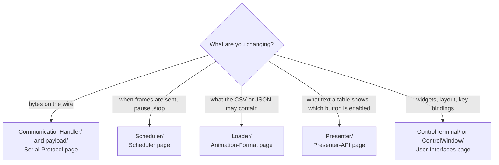

# Development Guide

For people changing the code: the repository map, the conventions the code follows, step-by-step recipes for common changes, and the open questions.

> **How this page was checked:** the conventions and recipes were derived from reading the code and checked against it. They were **not exercised** by building a new packet type or front end. The workflow facts (branches, ignored files) were read from the repository with git on Windows.

## Repository map

```text
ControlTower/                core (no UI imports)
  ControlTower.py            facade: wires Loader, Scheduler, CommunicationHandler
  common/                    Animation, Drone, Point, Color, enums (Command, DroneStatus,
                             DroneAnimationStatus), errors
  Loader/                    CSV + JSON loading
  Scheduler/                 dispatcher threads + telemetry listener
  CommunicationHandler/      CommunicationProtocol, CommunicationHandler, PacketType, payload/
  Presenter/                 DronePresenter, DroneRow, LogBuffer, Bootstrap
ControlTerminal/             Textual TUI (python -m ControlTerminal)
ControlWindow/               GTK4/libadwaita GUI (python -m ControlWindow); ui/window.blp
sample_animation/            3 drones, 12 frames, config.json with loop://
scripts/presenter_demo.py    bounded demo of the presenter layer
tests/                       pytest suite and helpers
docs/                        this wiki
.run/                        JetBrains run configurations (Run ControlTerminal, Pytest)
pytest.ini  .coveragerc  requirements.txt  requirements-gui.txt  LICENSE  README.md
```

`.gitignore` ignores `.venv`, `.coverage`, `htmlcov/`, `.idea/`, the generated `ControlWindow/ui/*.ui`, and `.agents/` (working notes of the tooling, not part of the project).

## Conventions seen in the code

- **One class per module, module named like the class** in `ControlTower/` (for example `Loader/Loader.py`, `Scheduler/Scheduler.py`). Each package `__init__.py` re-exports the public names in `__all__`.
- **Google-style docstrings** with `Args:`, `Returns:`, `Raises:` and `Attributes:` sections, on modules, classes and public methods.
- **Type hints** on signatures. The code uses Python 3.10 features: `match` statements and `X | None`.
- **Wire enums are part of the protocol.** `PacketType`, `Command` and `DroneStatus` values must not be renumbered; their docstrings say so.
- **Bad wire data is logged and skipped, never raised.** Bad file content is logged and skipped by the loader.
- **Threads never touch widgets.** Producers write data; the UI thread reads it.
- **Tests use independent expectations.** `tests/helpers/frames.py` builds wire frames without the code under test.
- One file name is a known typo and is left as it is: `common/DroneAnimationSatus.py` (the class inside is `DroneAnimationStatus`).

## Recipes

### Where does a change go?



### Add a packet type

1. Add the value to `PacketType` in `CommunicationHandler/PacketType.py`. Pick an unused byte; never change existing values.
2. Create a payload class in `CommunicationHandler/payload/`, modeled on `CPointPayload`: a dataclass with private fields, validation in the constructor (raise `ValueError` for bad input), and a `payload` property that returns the encoded bytes. Reuse `encode_float16` for floats.
3. Export it from `payload/__init__.py` and from `CommunicationHandler/__init__.py`.
4. To send it, add a `case` for the class in `CommunicationHandler.send` that calls `send_packet(PacketType.<NEW>, payload.payload)`.
5. To receive it, handle the new `PacketType` in `CommunicationHandler.listen` (today only `TELEMETRY` is handled and other types are skipped). Note that `_frame_problem` already accepts every `PacketType` value, so no framing change is needed.
6. Add tests: payload encoding, with `tests/helpers/frames.py` for the expected frame (see `test_CPointPayload.py` and `test_CommunicationHandler.py`), and a receive test with `FakeSerial`.
7. Update [Serial-Protocol](Serial-Protocol.md) and the README protocol tables.

### Add a drone command

1. Add the value to the `Command` enum in `common/Command.py` (keep the existing numbers).
2. Send it with `CommandPayload(drone_id, Command.<NEW>)` through `CommunicationHandler.send`. Its constructor checks that the id and the command value are in 0 to 255.
3. Add a test next to `test_CommandPayload.py`, and update [Serial-Protocol](Serial-Protocol.md#command-byte).

### Add a column to the drone tables

1. Add the field to `DroneRow` and fill it in `DronePresenter.rows()` (format it there, so both UIs agree).
2. Add the column to `COLUMNS` and `row_values` in `ControlTerminal/ControlTerminal.py`, and to `COLUMNS` and `row_values` in `ControlWindow/row_mapping.py`.
3. Add the matching string property to `DroneItem` in `ControlWindow/models.py`.
4. Update the presenter, TUI and `row_mapping` tests.

### Add a front end

1. Build a parser with `add_connection_arguments` and call `create_presenter(args)`.
2. Poll `rows()` and `button_states()` on your UI thread, or subscribe to the `LogBuffer` and hop to the UI thread.
3. Never touch widgets from a scheduler, serial or logging thread.
4. On exit call `tower.shutdown()` and `log_buffer.uninstall()`.
5. Catch `OSError` and `SerialConfigLoadFailed` around `create_presenter` and exit with code 2, as the two existing entry points do.

See [Presenter-API](Presenter-API.md) for a complete, verified example.

### Run the program without hardware

Use the `loop://` port, for example with the bundled sample (see [Getting-Started](Getting-Started.md#run-the-sample-animation)). The loopback only returns your own frames, so no telemetry arrives.

## Workflow facts

Read from the repository:

- Branches that exist: `main`, `dev`, `feature/portable-python-gtk4-gui` and `feature/project-documentation` locally; `origin/main` and `origin/dev` on the remote. Feature work is done on `feature/<topic>` branches.
- The commit history uses short free-form sentences. No file in the repository defines a commit message convention.
- There is no CI configuration in the repository (no `.github` folder and no `.gitlab-ci.yml`).
- No contribution or review rules are written down in the repository.
- Run `python -m pytest` before committing; the coverage gate is 85 %. See [Testing](Testing.md).

## Known limitations and open questions

| Item | State |
|------|-------|
| License headers | `LICENSE` is the MIT License, "Copyright (c) 2025 Mateusz K", and is the authoritative statement. The source files carry header comments that differ from it. This is known and not resolved; do not infer license terms from the headers, and do not rewrite them without a decision |
| GTK GUI | never run on a real display or GTK stack; the Blueprint file has never been compiled by a real `blueprint-compiler`. Check it on Linux |
| TUI interactive use | `--refresh 0` (exit 2) and the other exit codes in [User-Interfaces](User-Interfaces.md#exit-codes-checked-on-windows) were run on Windows. The interactive TUI itself has not been driven by hand in a real terminal |
| float16 byte order | commands little-endian, telemetry big-endian; unconfirmed against firmware |
| Telemetry animation byte | received, must be present, not decoded |
| `Drone.position`, `battery`, `command` | setters exist; production code never calls them |
| `ControlTower.send_to_point` | exists and is tested; no UI calls it |
| `SerialError` | defined and exported, never raised |
| `PING`, `PONG`, `DATA`, `ACK`, `ERROR` | exist as packet types; nothing sends or handles them |
| `PyGObject==3.58.1` pin | not install-tested (cannot be installed on Windows) |
| Windows line-ending warnings | git on Windows may print `LF will be replaced by CRLF` warnings, depending on its `core.autocrlf` setting; the repository has no `.gitattributes`. Not investigated further |

## See also

- [Testing](Testing.md)
- [Architecture](Architecture.md)
- [Serial-Protocol](Serial-Protocol.md)
- [Presenter-API](Presenter-API.md)
- [Glossary](Glossary.md)
