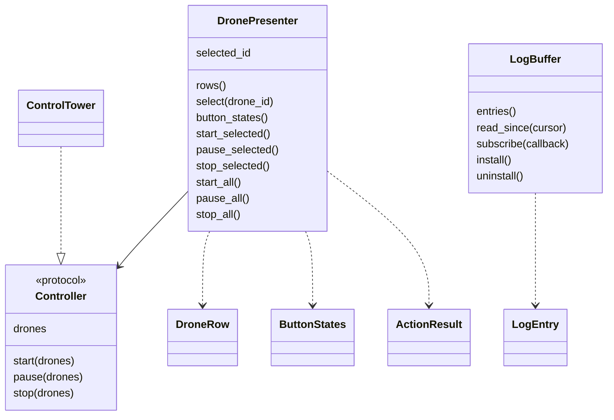
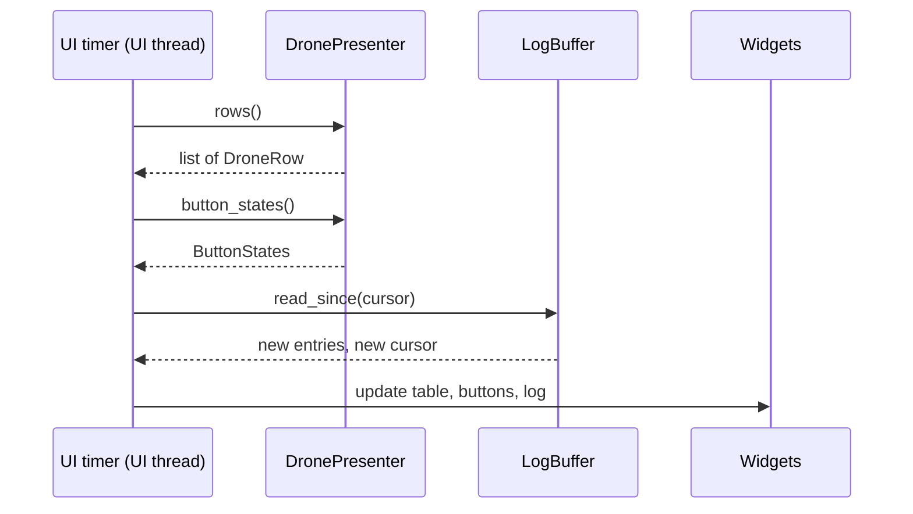

# Presenter API

How to build a new front end on `ControlTower.Presenter`, the UI-agnostic layer that both the TUI and the GUI use. It turns drone state into display rows and button states, and user actions into controller calls.

> **How this page was checked:** from reading `ControlTower/Presenter/` and its tests (`tests/ControlTower/Presenter/`). The code example below was run on Windows with Python 3.12.10 and its output is pasted unchanged.

## Why it exists

Both front ends render only what the presenter returns. No display formatting and no button logic is repeated in `ControlTerminal` or `ControlWindow`. Scheduler, serial and logging threads only produce data; the UI reads it on its own thread and is the only code that touches widgets.

## Public names

Everything in `ControlTower.Presenter.__all__`:

| Name | What it is |
|------|------------|
| `add_connection_arguments(parser)` | adds `animation_dir`, `--port`, `--speed` and `--timeout` to an `argparse` parser |
| `create_presenter(args)` | builds the `ControlTower`, a `DronePresenter` and an installed `LogBuffer`; returns `(tower, presenter, log_buffer)` |
| `DronePresenter` | rows, selection, button states and actions |
| `DroneRow` | one formatted table row (frozen dataclass) |
| `ButtonStates` | which buttons to enable (frozen dataclass) |
| `ActionResult` | outcome of an action: `ok` and `message` (frozen dataclass) |
| `Controller` | the `Protocol` the presenter needs: `drones`, `start`, `pause`, `stop`. `ControlTower` satisfies it |
| `LogBuffer` | thread-safe, bounded `logging.Handler` |
| `LogEntry` | one log line: `seq`, `level`, `name`, `message` |



## Bootstrap

`add_connection_arguments` adds the arguments both entry points share:

| Argument | Type | Help text |
|----------|------|-----------|
| `animation_dir` | positional | directory with the drone CSV files and an optional JSON serial config |
| `--port` | str | serial port or pyserial URL (e.g. COM3, /dev/ttyUSB0, loop://) |
| `--speed` | int | serial speed in baud |
| `--timeout` | float | serial read timeout in seconds |

`create_presenter(args)` returns `(tower, presenter, log_buffer)`. The log buffer is installed on the root logger. **The caller must clean up:** call `log_buffer.uninstall()` and `tower.shutdown()`. It can raise `FileNotFoundError`, `NotADirectoryError` (both are `OSError`), `SerialConfigLoadFailed`, or an `OSError` from pyserial if the port cannot be opened. Both entry points catch `OSError` and `SerialConfigLoadFailed` and exit with code 2.

### Log buffer and startup messages

`ControlTower` is built **before** the `LogBuffer` is installed. Messages from the loader (skipped files, malformed rows, a missing config file) therefore do not appear in a UI's log pane. They go to the console through Python's last-resort handler, which prints WARNING and above. In the run of `scripts/presenter_demo.py` the line `No config file with JSON format found in directory: ...` appeared on the console before the first output line. Messages logged after `create_presenter` returns (for example `Starting: 0`) are in the buffer.

## DronePresenter

### Rows

`rows()` returns one `DroneRow` per drone, sorted by id.

| `DroneRow` field | Type | Example | Rule |
|------------------|------|---------|------|
| `drone_id` | int | `1` | |
| `status` | str | `"Ok"` | `DroneStatus` name, `.title()` (`OK` becomes `Ok`) |
| `animation_status` | str | `"Live"` | `DroneAnimationStatus` name, `.title()` |
| `position` | str | `"2.00, 1.50, 1.00"` | the **reported** position, `:.2f` each |
| `position_error` | str | `"0.00"` | `Drone.position_error`, `:.2f` |
| `step_text` | str | `"2/12"` | `"{animation_step}/{animation_len}"` |
| `step` | int | `2` | the `animation_step` index |
| `length` | int | `12` | number of frames |

#### What the position columns mean

- `position` is the last position **reported by telemetry**. Before any telemetry arrives it is the first frame of the animation (the home position).
- `position_error` is the 3D distance between `Drone.position` and the reported position. No production code ever updates `Drone.position`, so it stays at the first frame. The error is therefore the distance of the reported position from the first frame, not from where the drone should be now.
- With `loop://` no telemetry arrives, so the position stays at home and the error is `0.00`.

### Selection

- `selected_id` is the selected drone id or `None`.
- `select(None)` clears the selection and returns `True`.
- `select(unknown_id)` returns `False` and keeps the previous selection.

### Button states

`button_states()` returns a `ButtonStates(start, pause, stop, start_all, pause_all, stop_all)`:

| Button | Enabled when |
|--------|--------------|
| `start` | the selected drone is `READY`, `PAUSED` or `ENDED` |
| `pause` | the selected drone is `LIVE` |
| `stop` | the selected drone is `LIVE` or `PAUSED` |
| `start_all`, `pause_all`, `stop_all` | at least one drone is in a state that the matching single-drone button accepts |

The selected-drone buttons are all off when nothing is selected.

### Actions

`start_selected`, `pause_selected`, `stop_selected`, `start_all`, `pause_all` and `stop_all` return an `ActionResult`:

| Situation | `ok` | `message` |
|-----------|------|-----------|
| selected action done | `True` | `Start requested for drone 1` (also `Pause ...`, `Stop ...`) |
| all action done | `True` | `Start requested for all drones (3)` |
| nothing selected | `False` | `No drone selected` |
| no drones loaded | `False` | `No drones loaded` |
| the controller raised | `False` | `Start failed for drone 1: <error>`; the exception is also logged |

"Requested" is literal: the presenter reports that it asked the controller, not that the drone changed state.

### Thread safety

`rows()` and `button_states()` read each drone attribute exactly once into a local variable, so one value is never torn. Fields of one row may come from slightly different moments (for example the step from one frame and the position from the next). The selection is guarded by a lock.

## LogBuffer

A `logging.Handler` that keeps the latest lines in a ring buffer.

| Member | Behavior |
|--------|----------|
| `LogBuffer(capacity=1000, level=logging.NOTSET)` | capacity below 1 raises `ValueError` |
| `entries()` | snapshot of the buffered lines, oldest first |
| `read_since(cursor=0)` | returns `(entries, new_cursor)`; pass `new_cursor` next time; lines already dropped from the ring buffer are skipped; with no new lines the cursor comes back unchanged |
| `subscribe(callback)` | calls `callback(entry)` for every new line and returns a function that unsubscribes; callbacks run on the thread that logged |
| `install(logger=None, level=logging.INFO)` | attaches to the root logger by default; lowers that logger's level to `level` if it would drop records |
| `uninstall()` | detaches and restores the level; harmless if not installed |

`LogEntry.seq` starts at 1 and grows by one for every line ever emitted. A toolkit that needs its main thread must hop over there from a `subscribe` callback itself (the GUI uses `GLib.idle_add`).

## Example: a minimal front end

> **Verified:** run on Windows with `.venv\Scripts\python.exe` from the repository root; the output is pasted unchanged. Step numbers vary from run to run.

```python
import argparse, time
from ControlTower.Presenter import add_connection_arguments, create_presenter

parser = argparse.ArgumentParser()
add_connection_arguments(parser)
args = parser.parse_args(["sample_animation", "--port", "loop://", "--speed", "115200", "--timeout", "0.2"])
tower, presenter, log_buffer = create_presenter(args)
try:
    presenter.select(1)
    print(presenter.button_states())
    print(presenter.start_selected())
    time.sleep(1.2)
    print(presenter.rows()[1])
    print(presenter.pause_selected())
    print(presenter.stop_all())
    entries, cursor = log_buffer.read_since(0)
    print([e.message for e in entries][-3:], cursor)
finally:
    log_buffer.uninstall()
    tower.shutdown()
```

Output:

```text
ButtonStates(start=True, pause=False, stop=False, start_all=True, pause_all=False, stop_all=False)
ActionResult(ok=True, message='Start requested for drone 1')
DroneRow(drone_id=1, status='Ok', animation_status='Live', position='2.00, 1.50, 1.00', position_error='0.00', step_text='2/12', step=2, length=12)
ActionResult(ok=True, message='Pause requested for drone 1')
ActionResult(ok=True, message='Stop requested for all drones (3)')
['Pausing animation for Drones(1)', 'Stopping Drone(1)', 'Stopping animation for Drones(0, 1, 2)'] 6
```

The script needs to run from the repository root (so `ControlTower` and `sample_animation` resolve). For a longer example that prints a live table, see `scripts/presenter_demo.py`. It builds a temporary animation, runs for about two seconds and exits with code 0:

```powershell
.venv\Scripts\python.exe scripts\presenter_demo.py
```

## The pattern for a UI

1. Build the parser with `add_connection_arguments` (add your own options if you need them) and call `create_presenter`.
2. On a timer on your UI thread, call `presenter.rows()` and `presenter.button_states()`, update the widgets, and read `log_buffer.read_since(cursor)` (or subscribe and hop to your main thread).
3. On a selection change call `presenter.select(drone_id)`. On a button press call the matching presenter method and show `result.message`.
4. On exit call `tower.shutdown()` and `log_buffer.uninstall()`.



`ControlWindow/row_mapping.py` is a small example of a consumer: it maps `DroneRow` values to column texts and computes what changed between two snapshots.

## See also

- [User-Interfaces](User-Interfaces.md)
- [Architecture](Architecture.md)
- [Scheduler-and-Drone-Lifecycle](Scheduler-and-Drone-Lifecycle.md)
- [Development-Guide](Development-Guide.md#add-a-front-end)
