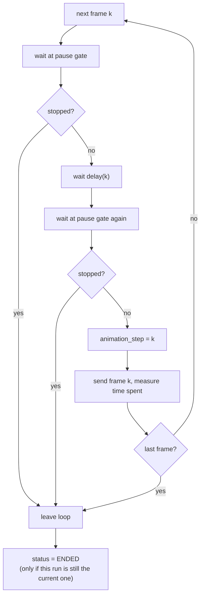
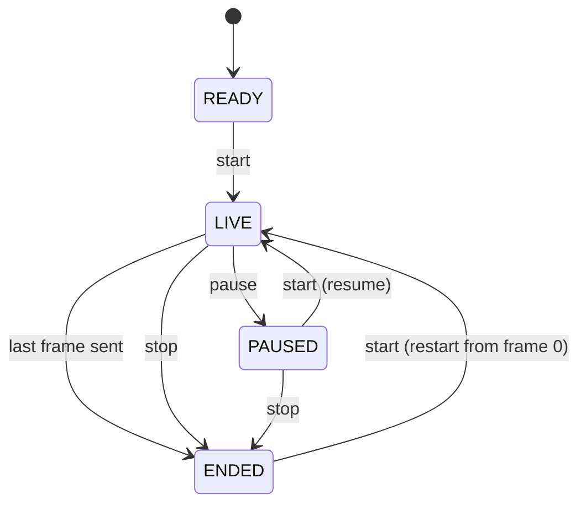

# Scheduler and Drone Lifecycle

How an animation is played: the threads, the frame timing, what `start`, `pause` and `stop` do, and how telemetry is applied. The code is `ControlTower/Scheduler/Scheduler.py`, driven by `ControlTower/ControlTower.py`.

> **How this page was checked:** from reading `Scheduler.py` and `Drone.py`, from the Scheduler tests (`tests/ControlTower/Scheduler/test_Scheduler.py`, which cover the transitions and the pause, stop and restart behavior with real threads), and from the script in [Verified run](#verified-run). Real-time pause and stop were not re-timed by hand.

## Two state variables per drone

| Property | Type | Values | Changed by |
|----------|------|--------|------------|
| `animation_status` | `DroneAnimationStatus` | `READY`, `LIVE`, `PAUSED`, `ENDED` | the Scheduler |
| `status` | `DroneStatus` | `LOST` (1), `INACTIVE` (2), `OK` (3) | incoming telemetry only; starts as `OK` |

`DroneAnimationStatus` lives in `ControlTower/common/DroneAnimationSatus.py` (the file name has a typo, the class is `DroneAnimationStatus`). Its values are `LIVE` = 1, `PAUSED` = 2, `ENDED` = 3, `READY` = 4.

Other drone fields: `animation_step` (index of the frame last handed to the dispatcher, 0-based), `reported_position` (from telemetry), `position` (the expected position, never updated by production code), `home_position` (the first frame), `battery` (0 to 100 or -1) and `command`. Nothing in the repository sets `battery` or `command`.

## Threads

- One **dispatcher thread** per drone, named `Dispatcher_Thread(<id>)`. It plays that drone's animation once.
- One **listener thread**, named `Listener`, started by the first `start()`. It iterates `comm.listen()` and applies telemetry.
- Both kinds are daemon threads by default (`daemon=True`), so they never block the interpreter from exiting.
- UI code talks to the scheduler only through `start`, `pause`, `stop` and `shutdown` (via `ControlTower`). See [Architecture](Architecture.md#threading-model).

## Frame timing

For frame `k` the dispatcher does, in this order:

1. Wait at the **pause gate** until the drone is not paused. If the run was stopped, leave the loop.
2. Wait the delay (below). With the default `sleep`, this wait ends at once when the run is stopped.
3. Pass the pause gate again, and leave if stopped.
4. Set `drone.animation_step = k`.
5. Call the operation (`ControlTower._dispatch_operation`), which sends frame `drone.animation_step` as a `CPOINT` packet, and measure how long it took.

```text
delay(0) = 0
delay(k) = max(0, (timestamp[k] - timestamp[k-1]) / 1000 - time_spent_in_previous_operation)
```

So the time a send takes is taken out of the next wait, and a send that takes longer than the gap gives a wait of zero instead of a negative one. Because `animation_step` is set before the operation runs, the operation always sends the frame it was started for. After the last frame the drone becomes `ENDED`.



There is no start barrier between drones. `Start all` starts the drones one after another in a loop, and each drone then keeps its own time. The drones are as synchronized as that loop and the serial link allow.

## Start, pause, stop

`start`, `pause` and `stop` take a list of drones; `None` means all drones. A drone that the scheduler does not manage is logged as a warning and ignored. Drone ids do not need to be contiguous.

| Action | When the drone is | Result |
|--------|-------------------|--------|
| start | `READY` or `ENDED` (including after `stop`) | new dispatcher thread, `animation_step` reset to 0, status `LIVE`: the animation **restarts from frame 0** |
| start | `PAUSED` | status `LIVE`, the gate opens: **resumes** from the frame it holds |
| start | `LIVE` | nothing |
| pause | `LIVE` | the gate closes, status `PAUSED` |
| pause | anything else | nothing |
| stop | `LIVE` or `PAUSED` | the run is stopped promptly, status `ENDED` |
| stop | `READY` or `ENDED` | nothing |
| last frame sent | `LIVE` | status `ENDED` (only if that run is still the current one) |



### What pause means

`pause` holds a running drone at its current frame and no frame is skipped. The gate is checked both before and after the wait between frames. A pause that lands during that wait therefore lets the wait run out, and the frame is sent right after `start` resumes the drone. The wait is not extended by the time spent paused, so after a resume the playback is late compared with the timestamps.

### What stop means

`stop` only stops the sending of animation frames. It sends **nothing** to the drones: no `RTH`, no `DISARM`, no hold position command. What a drone does when frames stop depends on its firmware, which is not in this repository. A frame that is being sent at the moment of `stop` is completed.

### Errors in the dispatcher thread

If sending a frame raises (for example a colour of 300 in the CSV, which is only detected when the frame is encoded), the exception ends that drone's thread with a traceback on the console, and the drone is marked `ENDED`. Other drones keep playing. See [Troubleshooting](Troubleshooting.md#a-drone-goes-to-ended-early-with-a-traceback-on-the-console).

## Telemetry

The listener thread iterates `comm.listen()`, which yields `TelemetryPayload` objects and `None` items (see [Serial-Protocol](Serial-Protocol.md#receiving)).

- `None` and non-telemetry items are ignored.
- For a known drone id, **only** `drone.status` and `drone.reported_position` are updated. The reported colour and the animation byte are ignored.
- Telemetry for an unknown id is logged as a warning and ignored.
- An exception in the listener is logged (`Telemetry listener stopped because of an error`) and the listener ends.
- The listener only starts once. It ends when `shutdown()` sets its stop flag and the telemetry source yields again, or when the source ends because the port is closed.

With `loop://` no telemetry arrives: the loopback only returns the host's own frames, which `listen()` skips because they are not telemetry. Rows therefore keep the home position and "Pos. error" stays `0.00`. See [Presenter-API](Presenter-API.md#what-the-position-columns-mean).

## Shutdown

`ControlTower.shutdown()` calls `Scheduler.shutdown()` and then closes the serial port.

- `Scheduler.shutdown()` sets the listener stop flag, stops every run, and joins each dispatcher thread with a timeout of 1.0 s (`SHUTDOWN_JOIN_TIMEOUT`).
- Closing the port ends `comm.listen()`, which ends the listener thread.
- A later `start()` starts a new listener.

## Verified run

This script uses the test helper `FakeClock` as both the clock and the `sleep`, so it needs no real waiting. It shows the delay rule and the restart behavior. Run from the repository root with `.venv\Scripts\python.exe`:

```python
import sys

sys.path.insert(0, ".")
from ControlTower.Scheduler import Scheduler
from tests.helpers.fakes import FakeComm, FakeClock, make_drone

clock = FakeClock()
sent = []
drone = make_drone(0, (0, 100, 300, 600))
scheduler = Scheduler(
    drones=[drone],
    dispatcher_operation=lambda d: sent.append(d.animation_step),
    telemetry_operation=FakeComm().listen,
    sleep=clock.sleep,
    clock=clock,
)
scheduler.start()
scheduler.dispatcher_threads[0].join(2)
print("sleeps:", [round(s, 6) for s in clock.sleeps])
print("steps sent:", sent)
print("status:", drone.animation_status.name)
scheduler.shutdown()

# restart after the end
scheduler.start()
scheduler.dispatcher_threads[0].join(2)
print("steps sent after restart:", sent)
scheduler.shutdown()
```

Output:

```text
sleeps: [0.0, 0.1, 0.2, 0.3]
steps sent: [0, 1, 2, 3]
status: ENDED
steps sent after restart: [0, 1, 2, 3, 0, 1, 2, 3]
```

The timestamps 0, 100, 300 and 600 ms give waits of 0, 0.1, 0.2 and 0.3 s. The frames are sent in order, the drone ends as `ENDED`, and a second `start()` plays the animation again from frame 0.

## Known issues

- `Drone.position`, `battery` and `command` have setters, but production code never calls them. `position` stays at the first frame, so "Pos. error" is the distance of the **reported** position from the first frame, not from the frame that should be reached now.
- `ControlTower.send_to_point` exists and is tested, but no UI calls it.

## See also

- [Architecture](Architecture.md)
- [Presenter-API](Presenter-API.md)
- [Serial-Protocol](Serial-Protocol.md)
- [Testing](Testing.md)
