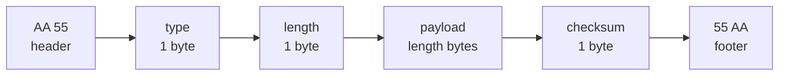
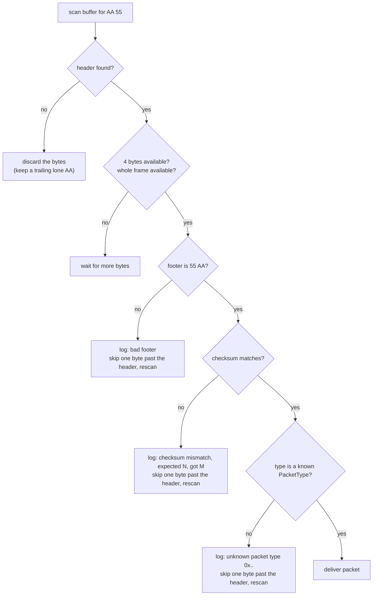
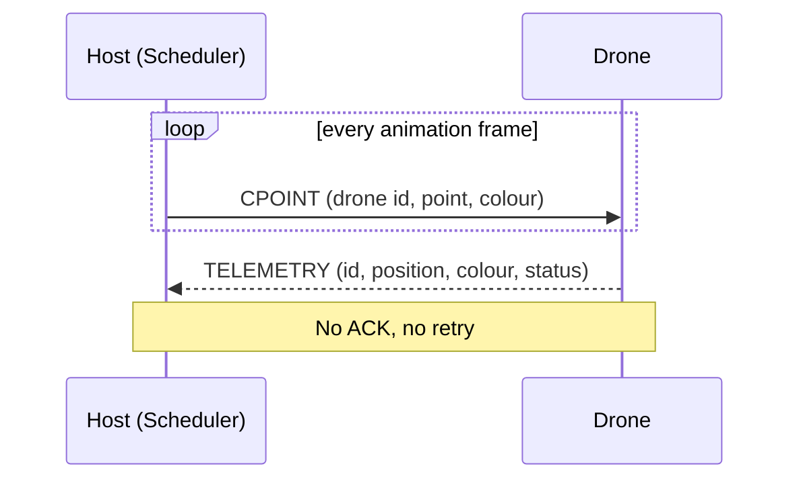

# Serial Protocol

How Hen-Brush talks to the drones: the frame layout, the checksum, every payload and what the receiver does with bad data. The code is in `ControlTower/CommunicationHandler/`.

> **How this page was checked:** layouts come from `CommunicationProtocol.py`, `PacketType.py`, the payload classes and `_float16.py`. The hex examples were produced by running the project code on Windows (Python 3.12.10, `loop://` port) and are pasted unchanged. The drone firmware is not part of this repository, so nothing here was checked against a real drone.

## Frame layout

Every message, in both directions, is one frame:

| Offset | Size | Field | Value |
|--------|------|-------|-------|
| 0 | 1 | header byte 1 | `AA` |
| 1 | 1 | header byte 2 | `55` |
| 2 | 1 | `type` | a [packet type](#packet-types) |
| 3 | 1 | `length` | number of payload bytes, 0 to 255 |
| 4 | N | `payload` | `length` bytes |
| 4 + N | 1 | `checksum` | XOR of `type`, `length` and every payload byte |
| 5 + N | 1 | footer byte 1 | `55` |
| 6 + N | 1 | footer byte 2 | `AA` |

The overhead is 7 bytes (`FRAME_OVERHEAD`), so a frame is `7 + length` bytes long. A payload longer than 255 bytes is refused with `ValueError("Payload too large")`.



### Checksum

The checksum is the XOR of all bytes from `type` up to and including the last payload byte. The header and the footer are not included.

```python
checksum = 0
for byte in data:          # data = type, length, payload...
    checksum ^= byte
```

## Packet types

Defined in `PacketType` (an `IntEnum`). The values are part of the wire protocol.

| Name | Value | Direction | Status in the code |
|------|-------|-----------|--------------------|
| `PING` | `0x01` | | defined; nothing sends or handles it |
| `PONG` | `0x02` | | defined; nothing sends or handles it |
| `DATA` | `0x03` | | defined; nothing sends or handles it |
| `ACK` | `0x04` | | marked `# Not Used` |
| `POINT` | `0x05` | host to drone | sent by `ControlTower.send_to_point` |
| `CPOINT` | `0x06` | host to drone | sent for every animation frame |
| `COMMAND` | `0x07` | host to drone | sent by `CommunicationHandler.send(CommandPayload)`; no UI sends it |
| `TELEMETRY` | `0x08` | drone to host | decoded by `CommunicationHandler.listen` |
| `ERROR` | `0xFF` | | marked `# Not Used` |

`send()` never waits for an `ACK` and never retries. A frame is written once and forgotten.

## Command byte

The second byte of the `POINT`, `CPOINT` and `COMMAND` payloads is a `Command` value:

| Command | Byte | Used by default in |
|---------|------|--------------------|
| `TELEMETRY_REQUEST` | `1` | the default value of `Drone.command` |
| `ARM` | `2` | |
| `POSITION_COLOR` | `3` | `CPointPayload` |
| `POSITION` | `4` | `PointPayload` |
| `RTH` | `5` | |
| `DISARM` | `6` | |

The repository does not say what the firmware does with `ARM`, `RTH` and `DISARM`, and no UI sends them. Do not renumber these values.

## Payloads

`f16` below is an IEEE 754 half-precision float, two bytes.

### POINT payload (8 bytes)

| Byte | Field | Encoding |
|------|-------|----------|
| 0 | `drone_id` | uint8, 0 to 255 |
| 1 | `command` | uint8, default `POSITION` (4) |
| 2-3 | `x` | f16, **little-endian** |
| 4-5 | `y` | f16, little-endian |
| 6-7 | `z` | f16, little-endian |

### CPOINT payload (11 bytes)

| Byte | Field | Encoding |
|------|-------|----------|
| 0 | `drone_id` | uint8, 0 to 255 |
| 1 | `command` | uint8, default `POSITION_COLOR` (3) |
| 2-3 | `x` | f16, little-endian |
| 4-5 | `y` | f16, little-endian |
| 6-7 | `z` | f16, little-endian |
| 8 | `r` | uint8, 0 to 255 |
| 9 | `g` | uint8, 0 to 255 |
| 10 | `b` | uint8, 0 to 255 |

### COMMAND payload (2 bytes)

| Byte | Field | Encoding |
|------|-------|----------|
| 0 | `drone_id` | uint8, 0 to 255 |
| 1 | `command` | uint8, the `Command` value |

### TELEMETRY payload (12 bytes, drone to host)

| Byte | Field | Encoding |
|------|-------|----------|
| 0 | `drone_id` | uint8 |
| 1-2 | `x` | f16, **big-endian** |
| 3-4 | `y` | f16, big-endian |
| 5-6 | `z` | f16, big-endian |
| 7 | `r` | uint8 |
| 8 | `g` | uint8 |
| 9 | `b` | uint8 |
| 10 | drone status | uint8: `LOST` = 1, `INACTIVE` = 2, `OK` = 3 |
| 11 | animation status | must be present; the value is **ignored** |

A payload that is not exactly 12 bytes, or whose status byte is not 1, 2 or 3, raises `ValueError` inside `TelemetryPayload`. `listen()` catches it, logs `Malformed telemetry payload <hex>: <reason>` at WARNING and yields `None`.

### Byte order

Commands (`POINT`, `CPOINT`) use **little-endian** float16. Telemetry uses **big-endian** float16. This asymmetry is documented in the code and kept as it is, because the firmware is not in this repository. It is a known, unconfirmed point: check it against the firmware before changing either side. See [Troubleshooting](Troubleshooting.md#telemetry-positions-look-mirrored-or-wrong).

### float16 encoding

Coordinates are encoded with `encode_float16` (`payload/_float16.py`), which uses NumPy's `float16`.

- Largest finite value: 65504. Precision is about three decimal digits, so values are rounded.
- A value that is not finite (`nan`, `inf`) or rounds to infinity raises `ValueError("Float value <v> out of range for float16")`. In the run below, 65504 was accepted, 70000 and `nan` were rejected. NumPy rounds to the nearest half-precision value, so a number a little above 65504 still encodes as 65504; 65520 and above is rejected.
- Colour channels and the drone id must be integers from 0 to 255; otherwise `ValueError` (`RGB values must be integers between 0 and 255`, `Drone ID must be an integer between 0 and 255`).
- All of this is checked when the payload object is created, which for animation frames means when the frame is sent.

## Worked example

> **Verified:** run on Windows with `.venv\Scripts\python.exe`, from the repository root. Output pasted unchanged.

```python
import sys; sys.path.insert(0, ".")  # run from the repository root
from functools import reduce

from ControlTower.common import Color, Command, Point
from ControlTower.CommunicationHandler import (
    CommandPayload, CommunicationHandler, CPointPayload, PacketType, PointPayload,
)

handler = CommunicationHandler("loop://", 115200, 0.2)

# CPOINT: drone 1, point (1.5, -2.0, 0.5), colour (255, 0, 128)
cpoint = CPointPayload(1, Point(1.5, -2.0, 0.5), Color(255, 0, 128))
frame = handler.create_packet(PacketType.CPOINT, cpoint.payload)
print("payload:", cpoint.payload.hex(" "))
print("frame:  ", frame.hex(" "))

# Checksum by hand: XOR of type, length and every payload byte.
checksum = reduce(lambda a, b: a ^ b, bytes([PacketType.CPOINT, len(cpoint.payload)]) + cpoint.payload)
print("checksum: %02x (frame byte: %02x)" % (checksum, frame[-3]))

# POINT: drone 2, point (1, 2, 3)
point = PointPayload(2, Point(1, 2, 3))
print("POINT   ", handler.create_packet(PacketType.POINT, point.payload).hex(" "))

# COMMAND: drone 3, ARM
command = CommandPayload(3, Command.ARM)
print("COMMAND ", handler.create_packet(PacketType.COMMAND, command.payload).hex(" "))

# Round trip through pyserial's loop:// port
sent = handler.send_packet(PacketType.CPOINT, cpoint.payload)
received = handler.read_packet(1)
print("round trip:", received["raw"] == sent, received["type"].name, received["payload"].hex(" "))
handler.close()
```

Output:

```text
payload: 01 03 00 3e 00 c0 00 38 ff 00 80
frame:   aa 55 06 0b 01 03 00 3e 00 c0 00 38 ff 00 80 b6 55 aa
checksum: b6 (frame byte: b6)
POINT    aa 55 05 08 02 04 00 3c 00 40 00 42 35 55 aa
COMMAND  aa 55 07 02 03 02 04 55 aa
round trip: True CPOINT 01 03 00 3e 00 c0 00 38 ff 00 80
```

### The CPOINT frame, byte by byte

| Bytes | Meaning |
|-------|---------|
| `aa 55` | header |
| `06` | type `CPOINT` |
| `0b` | length 11 |
| `01` | drone id 1 |
| `03` | command `POSITION_COLOR` |
| `00 3e` | x = 1.5 (f16 `0x3E00`, stored little-endian) |
| `00 c0` | y = -2.0 (f16 `0xC000`) |
| `00 38` | z = 0.5 (f16 `0x3800`) |
| `ff 00 80` | colour r = 255, g = 0, b = 128 |
| `b6` | checksum |
| `55 aa` | footer |

The checksum worked out by hand, XOR of `06 0b 01 03 00 3e 00 c0 00 38 ff 00 80`:

```text
06 ^ 0b = 0d    0d ^ 01 = 0c    0c ^ 03 = 0f    0f ^ 00 = 0f
0f ^ 3e = 31    31 ^ 00 = 31    31 ^ c0 = f1    f1 ^ 00 = f1
f1 ^ 38 = c9    c9 ^ ff = 36    36 ^ 00 = 36    36 ^ 80 = b6
```

The script's independent XOR gives `b6` too, which equals the byte in the frame.

### Telemetry, byte order and range errors

```python
import sys; sys.path.insert(0, ".")  # run from the repository root
from ControlTower.common import Point
from ControlTower.CommunicationHandler import (
    CommunicationHandler, PacketType, PointPayload, TelemetryPayload,
)

handler = CommunicationHandler("loop://", 115200, 0.2)

# Telemetry payload: drone 1, x y z as BIG-endian float16 (1.5, -2.0, 0.5),
# r g b = 255 0 128, status byte 3 (OK), animation byte 1 (present, not decoded).
raw = bytes.fromhex("01 3e 00 c0 00 38 00 ff 00 80 03 01")
handler.send_packet(PacketType.TELEMETRY, raw)   # loop:// hands the frame straight back
telemetry = next(handler.listen())
print(telemetry)

# Byte order of the same number, 1.5:
little = PointPayload(1, Point(1.5, 0, 0)).payload[2:4]   # commands: little-endian
print("1.5 in a command (little-endian):", little.hex(" "))
print("1.5 in telemetry (big-endian):   ", raw[1:3].hex(" "))

# Range check
for value in (65504, 70000, float("nan")):
    try:
        print(value, "->", PointPayload(1, Point(value, 0, 0)).payload[2:4].hex(" "))
    except ValueError as error:
        print(value, "-> ValueError:", error)
handler.close()
```

Output:

```text
TelemetryPayload(Id: 1, Point: 1.5 -2.0 0.5, Color: (R:255, G:0, B:128), Drone_Status: DroneStatus.OK)
1.5 in a command (little-endian): 00 3e
1.5 in telemetry (big-endian):    3e 00
65504 -> ff 7b
70000 -> ValueError: Float value 70000 out of range for float16
nan -> ValueError: Float value nan out of range for float16
```

## Receiving

`CommunicationProtocol` keeps a persistent receive buffer, so frames that arrive in pieces or several frames in one read are handled. Bad wire data is logged at WARNING and skipped; it never raises.



Messages logged by `_scan`. These three lines were produced on Windows by passing corrupted copies of the CPOINT frame above, and a frame with type `0x42`, to `parse_packet`:

```text
WARNING Dropping frame: bad footer (aa55060b0103003e00c00038ff0080b65500)
WARNING Dropping frame: checksum mismatch, expected 182, got 73 (aa55060b0103003e00c00038ff00804955aa)
WARNING Dropping frame: unknown packet type 0x42 (aa554201014255aa)
```

Public behavior:

- `read_packet(timeout=5)` returns a dict with `type` (`PacketType`), `payload` and `raw`, or `None` if no valid frame arrived within the timeout.
- `parse_packet(buffer)` parses the first valid frame in a byte string without touching the receive buffer.
- `listen()` yields a `TelemetryPayload` for each telemetry packet, or `None` when a read times out or a telemetry payload cannot be decoded. Packets of other types are skipped. It ends when the port is closed.
- `send()` accepts `PointPayload`, `CPointPayload` and `CommandPayload`; anything else raises `ValueError`.

## Ports and defaults

The port is opened with `serial.serial_for_url`, so the port can be a device name (`COM3`, `/dev/ttyUSB0`) or a pyserial URL such as `loop://`.

| Class | Baud | Timeout |
|-------|------|---------|
| `CommunicationHandler` | 115200 | 1 s |
| `CommunicationProtocol` (the base class) | 9600 | 1 s |

`ControlTower` creates its `CommunicationHandler` (unless one is injected) with the port, speed and timeout passed explicitly, so these defaults only matter when you use the classes directly.



## Known issues

- Little-endian commands versus big-endian telemetry (see [Byte order](#byte-order)).
- Telemetry byte 11 is required but not decoded.
- `PING`, `PONG`, `DATA`, `ACK` and `ERROR` exist as enum values but nothing uses them.
- `SerialError` is defined and exported in `ControlTower.common` and its docstring says `CommunicationHandler` raises it, but nothing raises it. A port that cannot be opened surfaces as a `serial.SerialException` (an `OSError`).

## See also

- [Architecture](Architecture.md)
- [Animation-Format](Animation-Format.md)
- [Scheduler-and-Drone-Lifecycle](Scheduler-and-Drone-Lifecycle.md)
- [Development-Guide](Development-Guide.md#add-a-packet-type)
- [Troubleshooting](Troubleshooting.md)
