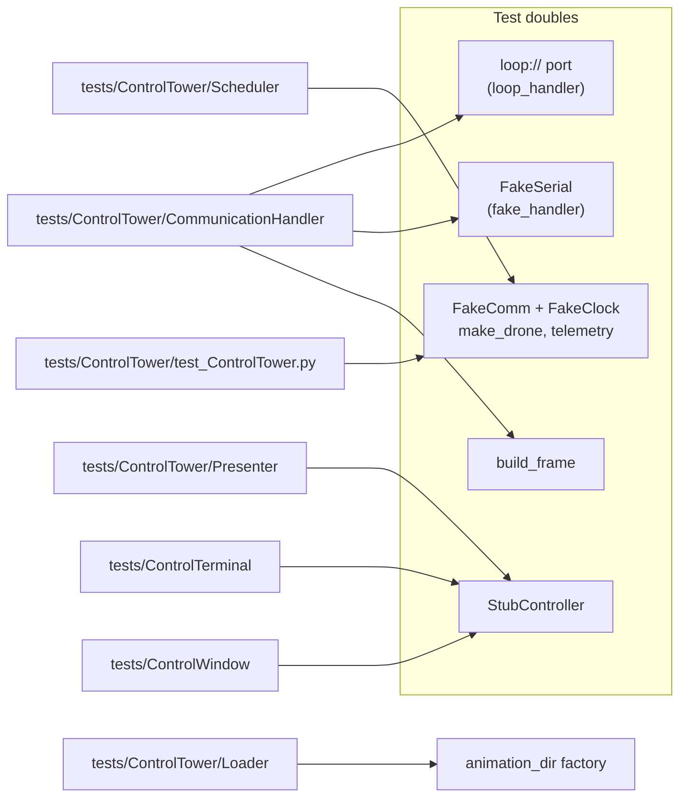

# Testing

How the test suite is laid out, how to run it, which test doubles exist and when to use each, and how to add a test.

> **How this page was checked:** the commands and numbers below come from runs on Windows with the project's `.venv` (Python 3.12.10, pytest 9.1.1, pytest-cov 7.1.0). The example test was run and passed. The GUI tests are skipped on this machine; how they would run on Linux is *not verified on this machine*.

## Running the tests

From the repository root, with the venv active (on Windows without activating: `.venv\Scripts\python.exe -m pytest`):

```bash
python -m pytest                      # everything, with coverage
python -m pytest -m "not gui"         # everything that runs without GTK
python -m pytest -m gui               # only the GUI tests
python -m pytest tests/ControlTower/Scheduler            # one folder or file
python -m pytest tests/ControlTower/Scheduler -k Restart # tests whose name matches
python -m pytest --no-cov -k Restart                     # skip coverage (and its gate) for a quick subset
```

Results on Windows:

| Command | Result |
|---------|--------|
| `python -m pytest` | **587 passed, 32 skipped** in about 38 s (31 to 38 s across runs); total coverage **99.38 %** |
| `python -m pytest -m "not gui"` | 587 passed, 32 deselected |
| `python -m pytest -m gui` | 32 skipped, 587 deselected |

## Configuration

`pytest.ini`:

| Setting | Value |
|---------|-------|
| `testpaths` | `tests` |
| `pythonpath` | `.` (the repository root, so `ControlTower`, `ControlTerminal` and `tests.helpers` import) |
| `addopts` | `-ra --cov --cov-branch --cov-report=term-missing --cov-fail-under=85` |

`-ra` prints a summary of skipped tests with their reasons. The run **fails when total coverage is below 85 %**, which also means a partial run can fail the gate; use `--no-cov` for subsets.

### Markers

Registered in `pytest.ini`:

| Marker | Meaning | Used today |
|--------|---------|------------|
| `gui` | needs GTK4/libadwaita and a display; skipped when unavailable | yes: `tests/ControlWindow/test_window_smoke.py` and `test_window_wiring.py` (via `pytestmark`) |
| `serial` | needs a real serial port; deselect with `-m "not serial"` | no test uses it (checked by searching `tests/`) |
| `slow` | takes more than a second | no test uses it |

### Coverage scope

`.coveragerc` measures the sources `ControlTower`, `ControlTerminal` and `ControlWindow`, with branch coverage. It omits `ControlWindow/models.py`, `window.py`, `app.py`, `ControlWindow/__main__.py`, any `*/__main__.py`, and `tests/*`. So the 99.38 % figure covers the core, the TUI and the GTK-free parts of `ControlWindow` (`row_mapping.py`, `ui_build.py`). It does not measure the GTK glue.

Last run: 1234 statements, 5 missed, 210 branches, 4 partial. The misses:

| File | Missing |
|------|---------|
| `ControlTerminal/ControlTerminal.py` | lines 203 and 219 |
| `ControlTower/Presenter/DronePresenter.py` | lines 25, 29, 33 (the `Controller` protocol method stubs) |
| `ControlTower/Scheduler/Scheduler.py` | partial branches `152->exit` and `281->280` |

Exact line numbers move as the code changes; the run wins over this table.

## Layout

```text
tests/
  conftest.py                      registers the shared fixtures from tests/helpers
  test_smoke.py                    imports work, factories work
  helpers/
    factories.py                   fixtures: rng, make_timestamps, make_flight_paths, make_colors, make_drones, animation_dir
    fake_serial.py                 FakeSerial class + fixtures: loop_serial_url, fake_serial, loop_handler, fake_handler
    fakes.py                       FakeClock, make_drone, telemetry, FakeComm
    frames.py                      build_frame: independent wire-frame builder
    decoders.py                    decode_command_payload, decode_point_payload, decode_cpoint_payload
    stub_controller.py             StubController
  ControlTower/
    common/                        Animation, Color, Drone, Point, enums, errors
    CommunicationHandler/          payloads, CommunicationProtocol, CommunicationHandler
    Loader/  Scheduler/  Presenter/
    test_ControlTower.py
  ControlTerminal/                 test_ControlTerminal.py (pilot tests), test_main.py
  ControlWindow/                   conftest.py (skip logic), test_main.py, test_row_mapping.py,
                                   test_ui_build.py, test_window_smoke.py, test_window_wiring.py
```



## Test doubles and when to use which

| Double | Where | Use it for |
|--------|-------|------------|
| `loop://` (`loop_handler` fixture) | `tests/helpers/fake_serial.py` | byte-exact round trips: whatever is written can be read back from the same object, on Windows and Linux, with no external setup |
| `FakeSerial` (`fake_serial` and `fake_handler` fixtures) | `tests/helpers/fake_serial.py` | what `loop://` cannot simulate: partial frames arriving over time (`feed_chunks`), garbage (`feed`), and silence. `fake_handler` patches `serial.serial_for_url` so a real `CommunicationHandler` uses it |
| `FakeComm` and `FakeClock` | `tests/helpers/fakes.py` | Scheduler and ControlTower tests. `FakeComm` records `send` calls and replays scripted telemetry; `FakeClock.sleep` advances time instantly and records every delay |
| `StubController` | `tests/helpers/stub_controller.py` | presenter and UI tests: implements the `Controller` protocol, records every call, and can be told to raise |
| `build_frame` | `tests/helpers/frames.py` | building expected wire frames **independently** of the code under test |

Factories (`tests/helpers/factories.py`) return callables so a test chooses the sizes. All randomness comes from the seeded `rng` fixture, so generated data is deterministic. Sample animations are written under pytest's `tmp_path`; nothing is written to the repository.

### The TUI tests

`tests/ControlTerminal/test_ControlTerminal.py` uses Textual's pilot (`App.run_test()`), run from ordinary sync tests with `asyncio.run` (no pytest-asyncio). A `StubController` stands in for the tower, so no threads and no serial port are involved. One test (`TestWithRealControlTower`) drives a real `ControlTower`.

## Writing a new test

Put it next to the code it covers (`tests/<Package>/...`). The shared fixtures are registered in `tests/conftest.py`, so they are available without imports. Prefer the test double that matches what you are testing (table above).

> **Verified:** this test was run on Windows and passed (`1 passed`). It lived outside `tests/` for the check, so it imports the two fixtures itself; inside `tests/` those imports are not needed.

```python
from ControlTower.CommunicationHandler import PacketType
from tests.helpers.fake_serial import fake_handler, fake_serial  # noqa: F401  (not needed inside tests/: tests/conftest.py registers them)
from tests.helpers.frames import build_frame


def test_frame_with_a_bad_checksum_is_dropped_and_the_next_one_is_read(fake_handler, fake_serial, caplog):
    good = build_frame(PacketType.TELEMETRY, bytes(12))
    bad = bytearray(good)
    bad[-3] ^= 0xFF  # corrupt the checksum byte
    fake_serial.feed(bytes(bad) + good)

    packet = fake_handler.read_packet(timeout=0.2)

    assert packet["raw"] == good
    assert "checksum mismatch" in caplog.text
```

Run a single test file the same way: `python -m pytest path/to/test_file.py --no-cov`.

## GUI tests and skipping

`tests/ControlWindow/conftest.py` adds a skip marker to every `gui`-marked test below `tests/ControlWindow` when the GUI cannot run. The skip reasons it can give:

- `GTK4/libadwaita not available: <error>` (on this machine: `No module named 'gi'`)
- `window.ui is out of date and 'blueprint-compiler' is not on PATH`
- `GTK could not be initialised: <error>`
- `no display available (set DISPLAY/WAYLAND_DISPLAY or run under xvfb-run)`

That is the 32 skips in the full run. The GTK-free GUI modules (`row_mapping.py`, `ui_build.py`, `ControlWindow/__main__.py`) have ordinary tests that run everywhere.

> **Not verified on this machine:** on Linux the GUI tests need GTK4, libadwaita, `blueprint-compiler` and a display. The skip message suggests `xvfb-run` for a headless machine (for example `xvfb-run python -m pytest -m gui`). The GUI tests have never been run here.

## See also

- [Development-Guide](Development-Guide.md)
- [Architecture](Architecture.md)
- [User-Interfaces](User-Interfaces.md#gui-controlwindow)
- [Troubleshooting](Troubleshooting.md#tests)
