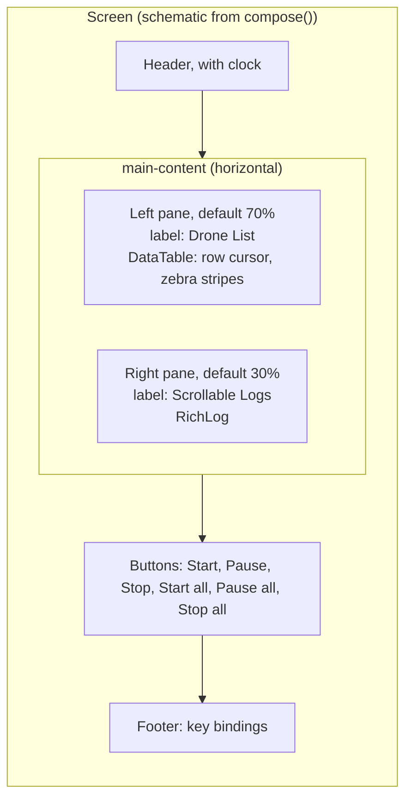
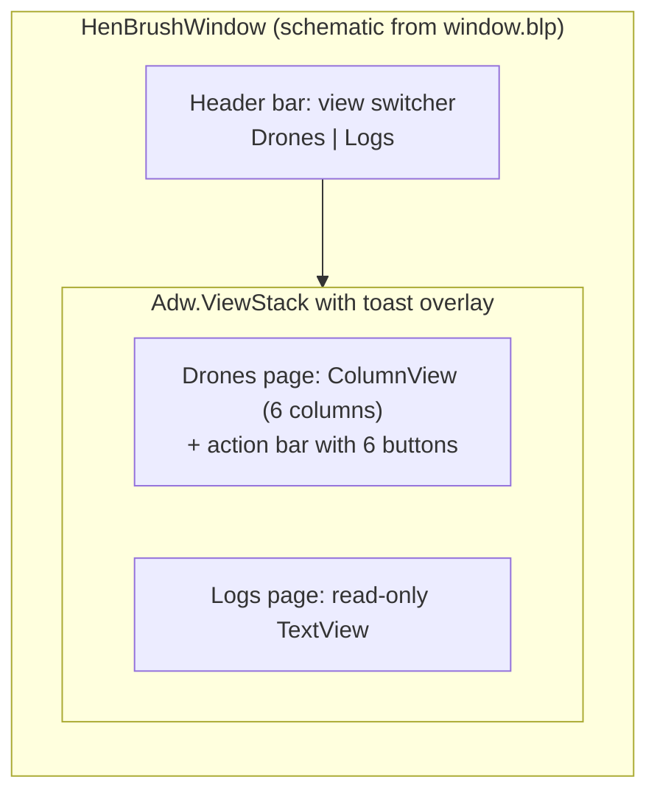
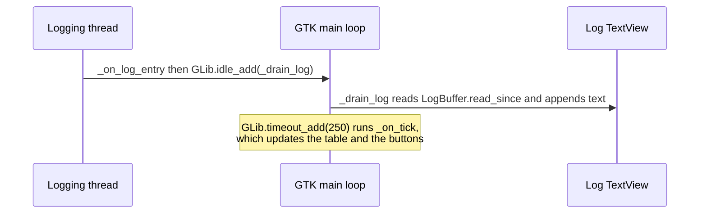

# User Interfaces

Hen-Brush has two front ends that share one presenter and one set of command-line options: a terminal UI (Textual) and a desktop GUI (GTK4 / libadwaita). This page covers both, as implemented.

| Front end | Platforms | Status |
|-----------|-----------|--------|
| TUI, `python -m ControlTerminal` | Windows, Linux | layout, bindings and error paths checked on Windows; covered by Textual pilot tests |
| GUI, `python -m ControlWindow` | Linux (GTK 4.10+, libadwaita 1.4+) | **not verified on this machine**, see the [GUI section](#gui-controlwindow) |

## What both front ends share

- The same arguments, added by `add_connection_arguments`: `<animation_dir>`, `--port`, `--speed` (int, baud) and `--timeout` (float, seconds). See [Presenter-API](Presenter-API.md#bootstrap).
- A drone table with six columns, in this order: **ID**, **Drone Status**, **Animation Status**, **Position**, **Pos. error**, **Animation Step**. The cell text comes from `DroneRow`; the TUI (`COLUMNS` in `ControlTerminal.py`) and the GUI (`COLUMNS` in `ControlWindow/row_mapping.py`) define the same six columns.
- Six buttons: **Start**, **Pause**, **Stop** for the selected drone, and **Start all**, **Pause all**, **Stop all**. Whether each is enabled comes only from `DronePresenter.button_states()`. See [Presenter-API](Presenter-API.md#button-states).
- Selecting a row selects that drone in the presenter.
- One refresh timer polls the presenter. Scheduler and logging threads never touch widgets.
- The same messages for action results (`Start requested for drone 1`, ...). The TUI writes them to the log pane, the GUI shows them as toasts.

---

## TUI (ControlTerminal)

### Command line

```text
python -m ControlTerminal <animation_dir> [--port PORT] [--speed SPEED] [--timeout TIMEOUT] [--refresh REFRESH]
```

Captured from `python -m ControlTerminal --help` on Windows:

```text
usage: python -m ControlTerminal [-h] [--port PORT] [--speed SPEED]
                                 [--timeout TIMEOUT] [--refresh REFRESH]
                                 animation_dir

Terminal UI for controlling a drone swarm.

positional arguments:
  animation_dir      directory with the drone CSV files and an optional JSON
                     serial config

options:
  -h, --help         show this help message and exit
  --port PORT        serial port or pyserial URL (e.g. COM3, /dev/ttyUSB0,
                     loop://)
  --speed SPEED      serial speed in baud
  --timeout TIMEOUT  serial read timeout in seconds
  --refresh REFRESH  seconds between screen refreshes (default: 0.25)
```

`--refresh` must be greater than 0. `--refresh 0` (or a negative value) is rejected by the argument parser.

### Exit codes (checked on Windows)

| Command | Result |
|---------|--------|
| `python -m ControlTerminal nodir` | exit 2, `ControlTerminal: Animation directory not found: nodir` |
| `python -m ControlTerminal README.md` | exit 2, `ControlTerminal: Animation path is not a directory: README.md` |
| `python -m ControlTerminal sample_animation --refresh 0` | exit 2, `python -m ControlTerminal: error: --refresh must be greater than 0` (after the usage text) |
| `python -m ControlTerminal sample_animation --port COM99 --speed 115200 --timeout 1` | exit 2, `ControlTerminal: could not open port 'COM99': FileNotFoundError(2, 'The system cannot find the file specified.', None, 2)` |
| a directory with CSV files but no JSON and no flags | exit 2, `ControlTerminal: No serial config detected` |
| normal quit (Ctrl+Q) | exit 0 |

The last row is the documented behavior (`main()` returns 0 after `run()`); the interactive session itself was not run by hand here. The interactive behavior is covered by the Textual pilot tests in `tests/ControlTerminal/test_ControlTerminal.py`.

### Layout



- The log pane starts with two lines: `Application started.` and `Use Ctrl+, to decrease left pane, Ctrl+. to increase.`
- A log line is written as the level padded to 8 characters, a space, then the message, for example `INFO     Starting: 0`. Messages from the presenter's actions (`Start requested for all drones (3)`) are written as they are.
- The log pane shows text literally (`markup=False`), so brackets in a message are not interpreted.
- The cursor row is selected from the start, and moving the cursor changes the selected drone.
- Buttons are disabled when the presenter says so. The variants are `success` (Start, Start all), `warning` (Pause, Pause all) and `error` (Stop, Stop all).
- On unmount the app calls the shutdown hook, which is `ControlTower.shutdown`.

### Key bindings

| Key | Action |
|-----|--------|
| `Ctrl+,` | make the left pane narrower (5 percentage points per press, minimum 20 %) |
| `Ctrl+.` | make the left pane wider (5 percentage points per press, maximum 80 %) |
| `Ctrl+Q` | quit (Textual built-in, priority binding) |
| `Ctrl+C` | bound by Textual to its `help_quit` action (a system binding); use `Ctrl+Q` to quit |
| command palette | Textual's command palette is enabled (`ENABLE_COMMAND_PALETTE` is `True`); the key is Textual's default |
| arrow keys | move the row cursor |

`Ctrl+,` and `Ctrl+.` are shown in the footer. Whether a terminal delivers these two key combinations depends on the terminal; they work in the Textual pilot tests, but they were **not tried in a real terminal** here. The right pane is always `100 - left` percent wide.

### Headless check

A headless run (Textual's `App.run_test()`, 120 x 24, refresh interval 0.1 s) on Windows against `sample_animation` over `loop://` clicked **Start all**, waited 0.8 s and pressed `Ctrl+,`. It is not an interactive session, but it shows what the widgets contain:

```text
left_width after ctrl+comma: 65
['ID', 'Drone Status', 'Animation Status', 'Position', 'Pos. error', 'Animation Step']
['0', 'Ok', 'Live', '0.00, 0.00, 1.00', '0.00', '2/12']
['1', 'Ok', 'Live', '2.00, 1.50, 1.00', '0.00', '2/12']
['2', 'Ok', 'Live', '4.00, 3.00, 1.00', '0.00', '2/12']
Application started.
Use Ctrl+, to decrease left pane, Ctrl+. to increase.
Start requested for all drones (3)
INFO     Starting: 0
INFO     Starting: 1
INFO     Starting: 2
ENABLE_COMMAND_PALETTE: True
```

The step numbers and the positions vary with timing (the positions stay at each drone's first frame, because `loop://` returns no telemetry).

---

## GUI (ControlWindow)

> **Not verified on this machine.** The GTK4 window has not yet been run on a real GTK stack, and its Blueprint file has not been compiled by a real `blueprint-compiler`. This section is derived from the code and from tests that are skipped here (32 GUI tests, reason `GTK4/libadwaita not available: No module named 'gi'`). The GTK-free modules (`row_mapping.py`, `ui_build.py`, and the logic in `__main__.py`) are tested everywhere.

### Requirements

Copied from `README.md` and `requirements-gui.txt`, not run here:

- Linux, GTK 4.10 or newer, libadwaita 1.4 or newer, `blueprint-compiler` 0.10 or newer.
- `PyGObject==3.58.1` from `requirements-gui.txt`. The pin itself is untested, because PyGObject cannot be installed on Windows.
- The system packages are listed in [Getting-Started](Getting-Started.md#linux-with-the-gui).

### Command line

```text
python -m ControlWindow <animation_dir> [--port PORT] [--speed SPEED] [--timeout TIMEOUT]
```

There is no `--refresh`; the GUI refreshes every 250 ms (`REFRESH_INTERVAL_MS`). The GUI passes an empty argument list to GTK, so GTK does not parse these options.

On this Windows machine:

```text
> python -m ControlWindow sample_animation --port loop:// --speed 115200 --timeout 1
ControlWindow: GTK4/libadwaita GUI is not available: No module named 'gi'
(exit code 1)
```

`python -m ControlWindow --help` works without GTK and prints the usage for the three shared options.

### Exit codes

| Code | Meaning |
|------|---------|
| application status (normally 0) | after a normal run |
| 2 | setup error: directory missing or not a directory, serial settings incomplete, port cannot be opened. One line on stderr |
| 1 | GTK4, libadwaita or `blueprint-compiler` is not available (`ImportError`, `ValueError` or `RuntimeError` while loading the GUI). GTK is loaded **before** the serial port is opened, so a missing GTK does not open the port for nothing |

### Blueprint build step

`ControlWindow/ui/window.blp` is the Blueprint source of the window. GTK needs the compiled `window.ui`.

- `window.py` calls `ensure_ui(...)` when it is imported, before the `Gtk.Template` decorator needs the file.
- `ensure_ui` runs `blueprint-compiler compile --output <window.ui> <window.blp>` only when `window.ui` is missing or older than the `.blp` (compared by modification time).
- Set the `BLUEPRINT_COMPILER` environment variable to use an executable that is not on `PATH`.
- If the compiler cannot be started or exits with an error, `ensure_ui` raises `RuntimeError`; the message includes install hints for Debian/Ubuntu, Fedora and Arch. `__main__` turns that into exit code 1.
- The generated `window.ui` is git-ignored (`ControlWindow/ui/*.ui`).

### Window

As declared in `window.blp` and `app.py`:

- Application id `org.henbrush.HenBrush`; window title "Hen Brush"; default size 1000 x 640.
- A header bar with an `Adw.ViewSwitcher` that switches between two pages of an `Adw.ViewStack`:
  - **Drones**: a `Gtk.ColumnView` (row and column separators) with the six columns above, and an action bar with the six buttons. The three single-drone buttons are in the action bar's start area, the three "all" buttons in its end area. All six start disabled.
  - **Logs**: a read-only monospace `Gtk.TextView` that wraps long lines.
- Results of actions are shown as toasts in an `Adw.ToastOverlay`. A failed action is also logged as a warning.
- The selection starts empty (`autoselect=False`) and can be cleared.
- The drone table is updated in place by a `GLib.timeout_add(250)` timer: only items that changed are touched, so selection and scroll position stay.
- The log view keeps at most 2000 lines (`MAX_LOG_LINES`) and scrolls to the end when lines arrive.
- Closing the window stops the timer and the log subscription. The application calls the shutdown hook (`ControlTower.shutdown`) once on shutdown; `__main__` calls it again in a `finally`.



### Threading rule

Only the GTK main loop touches widgets. `LogBuffer` subscribers run on whatever thread logged, so `_on_log_entry` only schedules work with `GLib.idle_add`; the widget work happens in `_drain_log` on the main loop. Button handlers already run on the main loop.



## Known issues

- The GUI has never been run on a real display or GTK stack, and the Blueprint file has never been compiled by a real `blueprint-compiler`. Check it on Linux.
- `Ctrl+,` and `Ctrl+.` in the TUI depend on the terminal and were not tried in a real terminal.
- The TUI selects the first row from the start; the GUI starts with no selection.

## See also

- [Getting-Started](Getting-Started.md)
- [Presenter-API](Presenter-API.md)
- [Architecture](Architecture.md)
- [Testing](Testing.md#gui-tests-and-skipping)
- [Troubleshooting](Troubleshooting.md)
